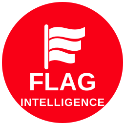

<p>
  
</p>
<br clear="both">

<h1 align="center">FLAG INTELLIGENCE</h1>

<p align="center">
  <strong>Recognize a national flag or enter a country name to generate a structured country intelligence report.</strong>
</p>

<p align="center">
  <a href="https://flag-intelligence.streamlit.app/"><strong>Live App</strong></a> · Version 0.1.0
</p>

Flag Intelligence combines **computer vision**, country information and AI-assisted report generation. Users can upload a flag image or enter a country name / ISO code; both paths lead to the same country-report workflow.

## Features

- **Two input modes:** flag-image recognition or direct country / ISO-code lookup.
- **Worldwide taxonomy:** 250 country and territory classes (249 ISO 3166-1 codes + Kosovo, `XK`).
- **Vision predictions:** confidence, ranked alternatives, ambiguity handling and an open-set decision.
- **Country Intelligence:** geography, history, government, culture, society, economy, education, science and practical information.
- **Reports:** structured country snapshot, map, authored narrative, and downloadable **PDF / JSON**.
- **Quality controls:** deterministic report checks, text cleanup, caching and fallback behavior when a report writer is unavailable.

Text-based lookup does not invent image-recognition confidence. The detail available in each country report depends on the underlying country data.

## How it works

```text
Flag image → MobileNetV3-Small → prediction / ambiguity decision ─┐
                                                                ├→ Country profile
Country name / ISO code → deterministic country resolver ────────┘         ↓
                                                           AI report generation
                                                                     ↓
                                                           Sanitization + QA
                                                                     ↓
                                                               PDF / JSON
```

The recognition model is stored at `artifacts/models/worldwide_mobilenet_v3_small.pt`. Visually similar flags, such as Côte d’Ivoire / Ireland and Chad / Romania, require particular care during prediction.

## Model evaluation

The project tracks classification, calibration, open-set recognition and inference efficiency, including Top-1 / Top-5 accuracy, macro F1, confusion matrices, ECE, AUROC and latency.

**Human-reviewed real-world challenge results:**

| Evaluated system | Top-1 | Top-5 |
|---|---:|---:|
| V1 worldwide classifier | 19.61% | 27.45% |
| Scene-aware V2 | 17.65% | 30.39% |
| Detector + V1 | 19.61% | 30.39% |

Flag-detector localization rate: **73.53%**. These results show that real-world flag recognition remains challenging; the alternative pipelines were not promoted because they did not improve Top-1 accuracy. The Wikimedia challenge set is reserved for evaluation.

## Get started

**Streamlit application:**

```bash
pip install -r requirements.txt
streamlit run app.py
```

**Tests:**

```bash
pytest
```

**Optional FastAPI development server:**

```bash
PYTHONPATH=src uvicorn serve:app --reload
```

### Local AI with Ollama (default)

The default report-writing backend is **Ollama**, using the local `qwen3:8b` model. Install Ollama first, then start the project using:

**Windows (PowerShell)**

```powershell
powershell -ExecutionPolicy Bypass -File scripts/run_free_local.ps1
```

**Linux / WSL**

```bash
chmod +x scripts/run_free_local.sh
./scripts/run_free_local.sh
```

The local app is available at `http://localhost:8501`. To change the model, set `FLAG_INTELLIGENCE_OLLAMA_MODEL` (for example, `qwen3:14b` if your machine has enough resources).

**Optional OpenAI backend:** set `FLAG_INTELLIGENCE_LLM_BACKEND=openai` and provide `OPENAI_API_KEY` securely through environment variables or Streamlit secrets. Never commit API keys.

For temporary access to the locally running app from another device, a Cloudflare Quick Tunnel can be used during development:

```bash
cloudflared tunnel --url http://localhost:8501
```

## Project layout

```text
country-flag-recognition/
├── app.py                    # Streamlit interface
├── serve.py                  # API development entry point
├── src/flag_recognition/     # Recognition and country-report modules
├── artifacts/                # Models, metrics and figures
├── data/                     # Datasets and reference resources
├── scripts/                  # Utilities and local startup scripts
├── configs/                  # Project configuration
├── tests/                    # Automated checks
├── requirements.txt
└── README.md
```

## Status and limitations

**V0.1.0** provides flag recognition, name/ISO lookup, country reports and PDF/JSON export. The project includes automated checks for report consistency across its 250-class taxonomy. Work continues on harder real-world flag images, ambiguity handling and the consistency of country-specific information. Time-sensitive facts, such as current government officials, should be checked against up-to-date sources.

**Live application:** https://flag-intelligence.streamlit.app/
